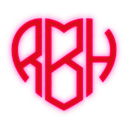
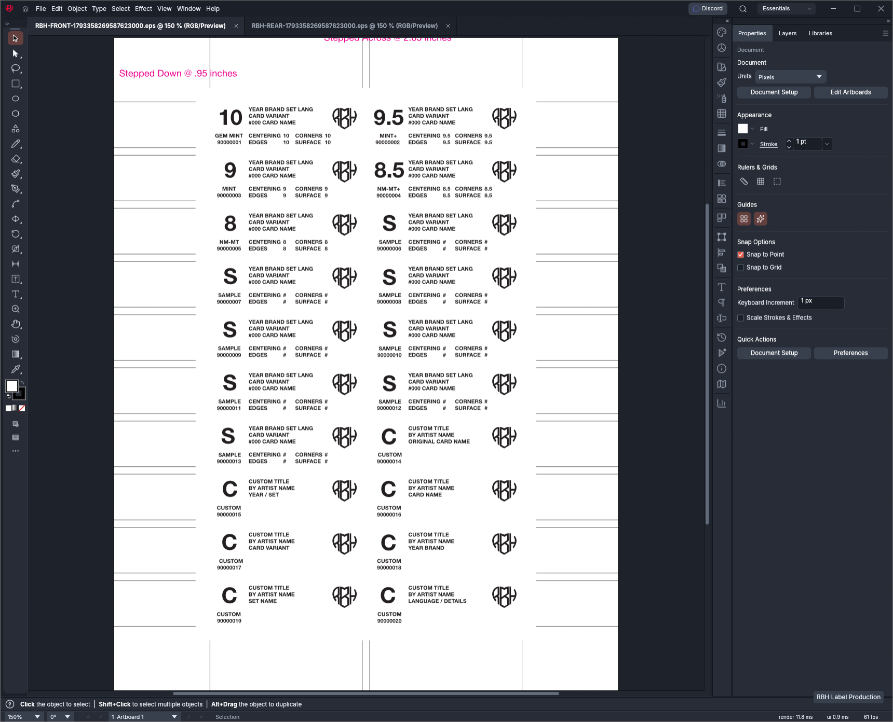
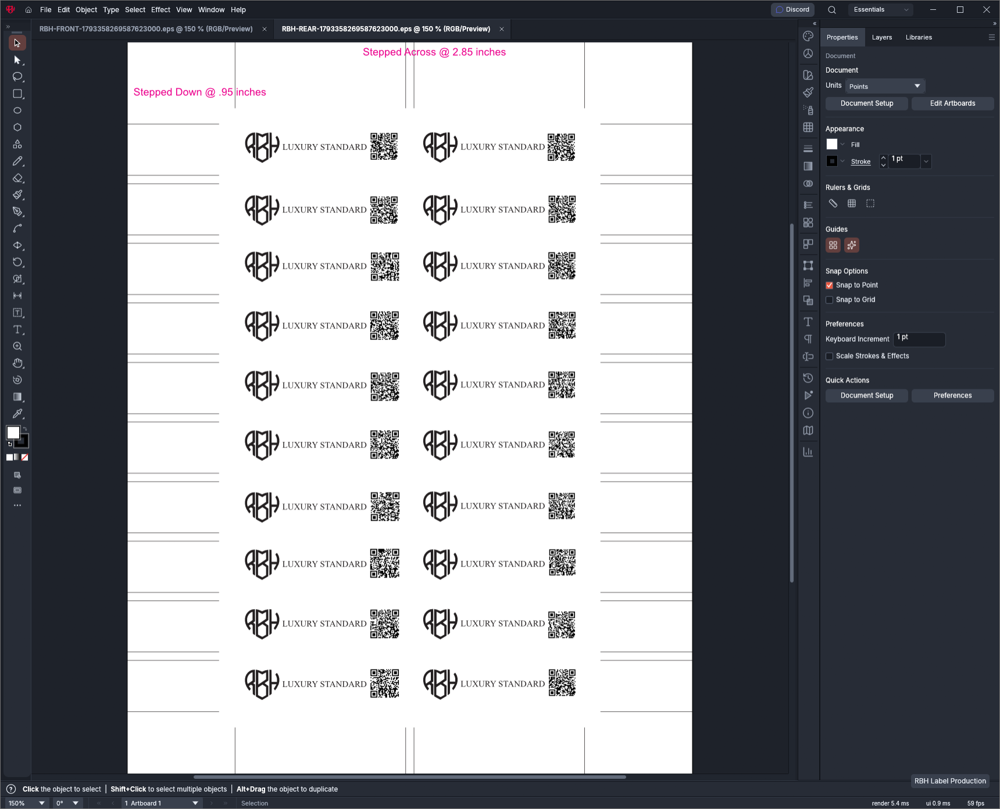

<p align="center">
  
</p>

<h1 align="center">RBH Label Studio</h1>

<p align="center"><strong>Luxury Standard — from certification data to print-ready label artwork.</strong></p>

<p align="center">
  A Windows-focused desktop workspace for producing RBH Grading certification-label sheets,<br>
  built on the open-source <a href="https://github.com/storytold/vectorcraft">VectorCraft</a> vector illustration editor.
</p>

<p align="center">
  <a href="https://www.rbhgrading.com">RBH Grading website</a> ·
  <a href="https://discord.gg/5jvBRNw27j">Discord</a> ·
  <a href="https://github.com/10Shilling6Pence/rbh-label-studio">Source code</a>
</p>

<p align="center">
  
  
  
  
</p>

> **Development build:** RBH Label Studio is currently developed and tested locally. This repository does not yet offer a separately packaged, supported RBH Label Studio installer. Production printing still requires operator review and physical proofing.

## What is RBH Label Studio?

RBH Label Studio extends VectorCraft with a local **RBH Label Production** workflow for certification labels. It imports an RBH Grading JSON export, validates the selected batch, fills calibrated front and rear artwork, and generates paired sheet files for print-shop review.

The underlying vector editor remains available for viewing and editing documents, including `.vectorcraft` files and exported EPS artwork. The RBH production workflow operates locally; it does not require a separate RBH database or a live connection to the RBH Grading website.

### Current RBH features

- **Batch import:** Import a local RBH Grading JSON export and inspect certification numbers.
- **Classification-aware labeling:** Handle graded, sample, and custom/altered cards without inventing missing grades.
- **Calibrated front sheets:** Populate a 20-label sheet using selected master artwork, real font measurements, and defined text rows/subgrade positions.
- **Mirrored rear sheets:** Arrange the backs for duplex registration, with an RBH monogram, Luxury Standard branding, and certification QR codes.
- **Paired local exports:** Produce matching front and rear `.vectorcraft` documents, PNG previews, and EPS files using one batch identifier.
- **Desktop workflow:** Select JSON, front and rear masters, calibration data, and an output folder inside RBH Label Studio.
- **RBH identity:** Branded Windows icon, welcome screen, and compact startup splash.

The current production tool requires **exactly 20 validated certifications** to enable full-sheet generation. Smaller imports can be reviewed but do not produce a full production sheet.

## Production previews

These screenshots show a complete **20-label demonstration batch** made with fictional certification numbers and placeholder card details; no customer submissions or real card identities are shown. The front includes graded cards (10, 9.5, 9, 8.5, and 8), sample labels, and custom labels.

### Front label sheet



### Mirrored rear label sheet



The rear artwork is mirrored for double-sided sheet alignment. These are demonstration screenshots, not approved printing proofs; physical registration must be verified before production.

## Production workflow

1. Open **RBH Label Production** from the launcher in the editor's lower-right corner.
2. Import the RBH Grading JSON export and verify all **20 / 20** certifications are present.
3. Select the **front master** and **rear master** `.vectorcraft` files.
4. Select the corresponding **calibration JSON** and an existing output folder.
5. Choose **Generate Front + Mirrored Rear and Export EPS Pair**.
6. Review the generated front/rear PNG previews and open the `.vectorcraft` or EPS sheets for closer inspection.
7. Confirm text fit, front-to-back registration, correct QR targets, and print-shop requirements before approving printing.

A completed batch produces six local files: front/rear `.vectorcraft`, front/rear `.png`, and front/rear `.eps`. Files are generated without overwriting existing results.

**Printing note:** A correct screen preview is not a substitute for checking your printer's physical registration, material, color requirements, and finished-label alignment.

### Inputs and local assets

The application uses your own production JSON export, master documents, and calibration JSON. These are **not** included as public customer or production assets in this repository. Keep private submission data, licensed fonts, and proprietary print artwork outside source control.

A fictional schema example is available at [`crates/rbh-labels/examples/example_batch.json`](crates/rbh-labels/examples/example_batch.json). The import rules and label-layout contract are documented in [`crates/rbh-labels/README.md`](crates/rbh-labels/README.md).

## Build from source

The development workflow below is intended for Windows with a working Rust toolchain, Cargo, and the required native build dependencies for VectorCraft. The application remains based on the larger VectorCraft workspace; first builds may take time and require substantial disk space and memory.

```powershell
git clone https://github.com/10Shilling6Pence/rbh-label-studio.git
cd rbh-label-studio
git switch rbh-development
```

Build the desktop application, production generators, and converter:

```powershell
cargo build -p vectorcraft -p rbh-label-fonts -p vectorcraft-cli -j 1
```

Launch the Windows desktop application:

```powershell
.\target\debug\vectorcraft.exe
```

The executable currently retains the filename `vectorcraft.exe` for compatibility with the existing workspace. The Windows-facing branding identifies the application as RBH Label Studio.

### Tests and development checks

```powershell
cargo check -p vectorcraft -j 1
cargo test -p rbh-labels -j 1
cargo test -p rbh-label-fonts -j 1
```

The `-j 1` setting limits parallel build jobs and can help on memory-constrained systems. Further upstream development information is available in [`docs/development.md`](docs/development.md).

## Project structure

| Path | Purpose |
| --- | --- |
| `apps/vectorcraft/` | RBH-branded desktop app and label-production workspace |
| `apps/vectorcraft/src/rbh_workspace.rs` | Local batch import and paired export UI |
| `apps/vectorcraft/src/rbh_splash.rs` | Branded startup splash |
| `crates/rbh-labels/` | Certification import, validation, and label rules |
| `crates/rbh-label-fonts/` | Font measurement and front/rear proof generators |
| `apps/vectorcraft-cli/` | Vector document conversion and EPS/PNG export |
| `crates/ui-egui/` | VectorCraft editor interface and RBH welcome branding |

## Relationship to VectorCraft

**RBH Label Studio is an independently modified fork of [VectorCraft](https://github.com/storytold/vectorcraft)**. VectorCraft provides the core vector illustration engine, file formats, editor, and much of the existing UI. RBH-specific additions focus on branding, certification data, calibrated label generation, and print production.

This project is **not an official ArtCraft or VectorCraft release** and is not affiliated with or endorsed by the original maintainers. See the [upstream repository](https://github.com/storytold/vectorcraft) for the original project, documentation, and broader cross-platform development work.

## License, credits, and trademarks

The inherited open-source code remains available under the repository's dual-license terms: **[MIT](LICENSE-MIT) OR [Apache-2.0](LICENSE-APACHE)**, at your option, subject to applicable third-party asset licenses. Original copyright and attribution notices are preserved in [`NOTICE`](NOTICE), [`ASSETS.md`](ASSETS.md), and the source files.

The VectorCraft application and its underlying code originate from the **ArtCraft team and VectorCraft contributors**. RBH-specific changes are developed for **RBH Grading / RBH eHoldings LLC**.

The names and marks **RBH**, **RBH Grading**, and **Luxury Standard**, together with original RBH brand artwork, identify RBH's business and are not granted as trademarks merely by the code's open-source license. Likewise, upstream ArtCraft branding and other third-party marks remain the property of their respective owners. See repository asset notices for applicable terms.

---

<p align="center">
  <strong>RBH Label Studio</strong><br>
  <sub>Luxury Standard · <a href="https://www.rbhgrading.com">RBH Grading</a></sub>
</p>
